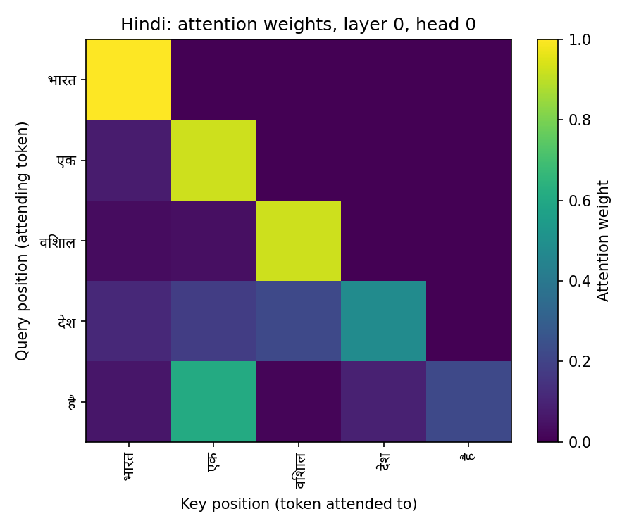
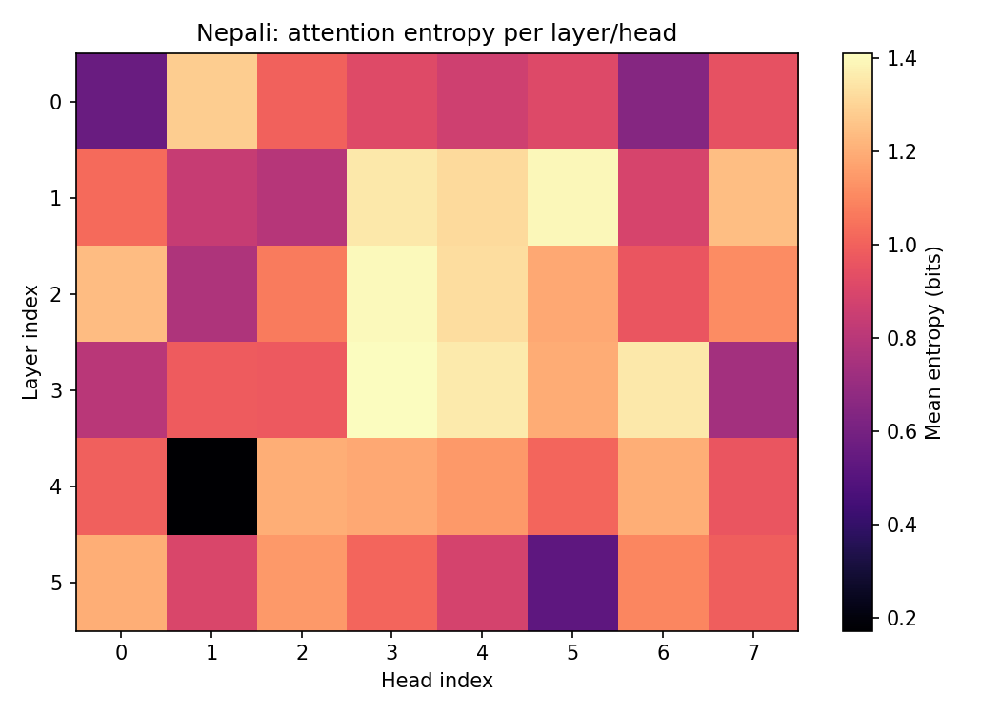
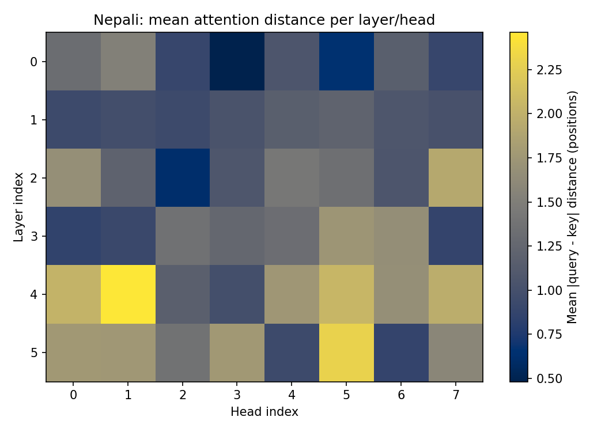

# Phase 2 Report: Model Implementation, Pretraining, and Evaluation

**Model H (higher-resource): Hindi. Model L (lower-resource): Nepali.**
Both are fully independent decoder-only Transformer language models — separate data, separate
tokenizer/vocabulary (from Phase 1), separate weights, separate training runs. Neither model was
initialized from the other, and no code, tokenizer, or vocabulary is shared between
[`hindi/`](../hindi/) and [`nepali/`](../nepali/).

---

## 1. Architecture (Section 2.1)

### 1.1 Input representation

Token ids are mapped to `d_model`-dimensional vectors via a learned embedding table
(`vocab_size × d_model`), scaled by `sqrt(d_model)` (the original Transformer-paper convention),
followed by embedding dropout ([`embeddings.py`](../hindi/model/embeddings.py)).

**Positional encoding: Rotary Position Embedding (RoPE), not learned-absolute or sinusoidal.**
RoPE rotates the query and key vectors, in consecutive dimension pairs, by an angle proportional
to sequence position, at *every* attention layer — rather than being added once at the input and
left for the network to propagate indirectly through depth. Two vectors rotated this way produce a
dot product that depends only on their *relative* position, so relative position falls directly out
of the attention score computation itself. RoPE was chosen over sinusoidal/learned-absolute because:

- it re-injects position information fresh into every layer rather than only the first,
- it generalizes better to relative reasoning (useful for the comparative/ordering reasoning tasks
  planned for Phase 3), and
- it is the current default across essentially every major open LLM since ~2022 (Llama, Mistral,
  Qwen), so implementing it directly targets what a "from-scratch modern decoder" looks like.

**How it constrains maximum sequence length**: this implementation precomputes RoPE's cos/sin
rotation tables once, up to `context_length` (256), as non-persistent buffers
([`rope.py`](../hindi/model/rope.py)). `RotaryPositionalEmbedding.forward` explicitly raises a
`ValueError` if asked for a longer sequence than that. This is a specific implementation choice
(precompute-and-cap), not a fundamental property of RoPE — the rotation formula itself is defined
for any position — but since both models are trained and evaluated at a fixed `context_length=256`
throughout, capping the precomputed table there is simpler and catches any accidental over-length
input immediately rather than silently extrapolating into untrained territory.

### 1.2 Multi-head causal self-attention

Implemented from first principles in [`attention.py`](../hindi/model/attention.py) — only
`nn.Linear`/`nn.Dropout` as primitives, no `nn.MultiheadAttention`, no `nn.Transformer*`:

1. A single fused `nn.Linear(d_model, 3*d_model)` projects `X` to `Q, K, V` together (mathematically
   identical to three separate `d_model × d_model` projections, just one matmul).
2. Each of `(B, T, d_model)` is reshaped to `(B, n_heads, T, d_head)` with `d_head = d_model /
   n_heads` (512/8 = 64), via `view` then `transpose(1, 2)`.
3. RoPE is applied to `Q` and `K` only (never `V`, which carries content, not position).
4. Scaled dot-product scores: `(Q @ K.transpose(-2,-1)) / sqrt(d_head)`. The `1/sqrt(d_head)`
   scaling keeps dot-product magnitudes roughly unit-variance regardless of head width — without it,
   larger `d_head` pushes scores to extreme values, driving softmax toward one-hot outputs and
   starving gradients.
5. **Causal masking**: a precomputed upper-triangular boolean buffer marks every `(query, key)` pair
   with `key position > query position`; those get `-inf` added before softmax, so position `t`
   attends only to positions `≤ t`.
6. Heads are concatenated back to `(B, T, d_model)` and passed through the output projection `W_O`.

**Empirical causal-mask verification** (part of the eval pipeline): change only the last token of an
input sequence and assert every earlier position's logits are bitwise identical (`torch.equal`) to a
run without that change, while confirming the changed position's *own* logits do differ — proving
the mask blocks future information without simply masking everything.

### 1.3 Transformer block

Each block ([`block.py`](../hindi/model/block.py)) is: pre-norm LayerNorm → causal self-attention →
residual add → pre-norm LayerNorm → feed-forward (`Linear(d_model→d_ff)` → GELU →
`Linear(d_ff→d_model)` → dropout) → residual add. **Pre-norm** (normalize *before* each sublayer,
not after) was chosen over post-norm because it keeps the residual stream itself unnormalized, so
gradients flow through the residual path largely unimpeded back to earlier layers — post-norm's
residual-path normalization tends to cause vanishing/unstable gradients as depth grows and typically
needs a longer learning-rate warmup to compensate. Dropout is applied in three places: attention
probabilities (`attn_dropout`), the attention output projection and FFN output (`resid_dropout`),
and the embedding output (`embed_dropout`) — all 0.1.

### 1.4 Output head and objective

A `Linear(d_model, vocab_size, bias=False)` projects the final hidden state to next-token logits.
**Weight-tied** to the input token embedding (`output_head.weight = token_embedding.weight`), which
saves `vocab_size × d_model` = 10,000 × 512 = **5.12M parameters** — roughly a fifth of the 25M
budget — freeing that capacity for attention/FFN layers instead of a second, separately-learned
vocab-sized matrix, and is a reasonable inductive bias (the same embedding space both reads a token
in and scores candidates out). Trained with the standard causal-LM objective: cross-entropy between
the logits at position `t` and the token at position `t+1`, averaged over all positions
([`gpt.py`](../hindi/model/gpt.py)).

### 1.5 Configuration and parameter count

Both models use an identical architecture shape (only weights differ, trained independently):

| Hyperparameter | Value |
|---|---|
| `vocab_size` | 10,000 (from each language's own Phase 1 SentencePiece tokenizer) |
| `d_model` | 512 |
| `n_layers` | 6 |
| `n_heads` | 8 (`d_head` = 64) |
| `d_ff` | 2,208 |
| `context_length` | 256 |
| Positional encoding | RoPE (base 10,000) |
| Activation | GELU |
| Norm placement | Pre-norm |
| Dropout (embed/attn/resid) | 0.1 / 0.1 / 0.1 |
| Weight tying | Yes (input embedding ↔ output head) |
| **Exact parameter count** | **25,019,328** (both models, verified via `GPTLanguageModel.num_parameters()`) |

**Depth/width trade-off justification**: `d_ff=2208` is a deliberate departure from the common
4×`d_model` ratio (which would give 2048 and 24.04M params) — chosen specifically to land almost
exactly on the ~25M target (25,019,328, +0.08%) without changing depth or width. Depth (6 layers)
and width (512) themselves were kept in the moderate middle of the feasible range for a 25M budget
on free Kaggle GPU compute (T4×2/P100, single-session time limits, hence the mandatory
checkpoint-resume pipeline): going substantially deeper (e.g. 12 layers) at the same budget would
require shrinking `d_model` well below 512, hurting each layer's per-token representational capacity
more than the extra depth would buy back; going shallower/wider risks under-using the sequential,
compositional structure attention needs several layers to build up. Six layers at `d_model=512`
keeps every layer reasonably expressive while still comfortably fitting the compute and time budget.

### 1.6 Additional design-decision justifications

A few further architecture choices, stated in the config table above but not yet explained:

- **GELU over SwiGLU** (both permitted by the assignment): GELU was chosen for a simpler,
  well-understood non-linearity at this scale. SwiGLU's gating mechanism needs roughly 1.5x the
  hidden width to stay parameter-matched against a plain GELU feed-forward of the same budget,
  adding tuning complexity without a clearly demonstrated benefit at 25M parameters — the
  literature's SwiGLU gains are best evidenced at much larger scale.
- **8 heads, `d_head=64`**: not 4 (too few, each head forced to represent an overly broad mix of
  relationships) or 16 (`d_head=32`, too narrow to give each head a useful subspace). 64 sits in
  the conventional range (typically 64-128) used across GPT-2/3-style models at comparable
  `d_model`, letting each head specialize while keeping enough dimensions per head to be
  expressive.
- **`context_length=256`**: attention cost scales quadratically with sequence length, so this is
  a direct compute-budget trade-off, not an arbitrary number. 512 or 1024 would roughly
  4x/16x the attention FLOPs per step for the same batch size, meaningfully slowing throughput on
  a single free Kaggle GPU session within a bounded time limit; 256 was chosen to keep training
  fast enough to reach 30,000 steps in the available compute, while still covering multiple
  sentences of real context per example.
- **Fused QKV projection** (`nn.Linear(d_model, 3*d_model)` instead of three separate
  `d_model -> d_model` layers): an *implementation*-efficiency choice, not an architectural one —
  mathematically identical to three separate projections, but one matmul instead of three reduces
  kernel-launch overhead.
- **Reusing Phase 1's `vocab_size=10,000` tokenizer as-is**: because Phase 1's SentencePiece
  tokenizers were trained with `byte_fallback=True`, both languages already had a **0.0% UNK
  rate** on held-out text before Phase 2 began — so Phase 2 training never had to design around
  unrepresentable tokens, a Phase 1 decision that quietly simplified Phase 2's data pipeline.

---

## 2. Pretraining (Section 2.2)

Both models were pretrained independently with AdamW (`β1=0.9, β2=0.95, eps=1e-8, weight_decay=0.1`,
`grad_clip_norm=1.0`), a linear warmup (1,000 steps) into cosine decay from `3e-4` down to `3e-5`
over the remaining steps, periodic validation-loss evaluation every 500 steps, and checkpointing
every 1,000 steps. Each checkpoint contains model weights, optimizer state, scheduler state, the
current training step, and the run's full config
([`trainer.py`](../hindi/train/trainer.py)) — required because Kaggle GPU sessions can terminate
mid-run; `Trainer.train(resume=True)` auto-finds and loads the highest-step checkpoint, and the
`while self.step < max_steps` loop naturally no-ops if training is already complete, so
interrupted/resumed runs never restart from scratch or double-count steps.

Both models trained for **30,000 steps** at `batch_size=64 × context_length=256` = 16,384
tokens/step → **491,520,000 (~491.5M) tokens processed**, against each language's own ~500M-token
Phase 1 corpus (Hindi: 506.81M tokens, 21.07% manual; Nepali: 500.24M tokens, 20.04% manual) —
approximately one full pass over each training split, matching the assignment's ~500M-token
pretraining target for both models. Neither model was initialized from the other; each instantiates
its own `GPTLanguageModel` with its own randomly-initialized weights.

**Training-hyperparameter justifications**:

- **`30,000` steps was not an arbitrary round number** — it follows directly from
  `batch_size × context_length = 16,384` tokens/step: `30,000 × 16,384 ≈ 491.5M` tokens, chosen
  to land at approximately one full pass over each ~500M-token corpus, matching the assignment's
  pretraining-token target while fitting inside a Kaggle GPU session's practical time budget.
- **AdamW `β2=0.95`** (PyTorch's default is `0.999`): a smaller `β2` shortens the optimizer's
  gradient-variance averaging window, making it adapt faster early in training — a convention
  from GPT-3/nanoGPT-style small-to-mid-scale LLM training recipes, used here for the same
  reason: faster useful progress within a limited step budget, at some cost to late-training
  smoothness that a longer, larger-scale run wouldn't need to trade off.
- **Linear warmup (1,000 steps) into cosine decay**, rather than a constant learning rate: warmup
  avoids destabilizing the randomly-initialized weights with the full peak learning rate before
  the optimizer's moment estimates have accumulated any real signal; cosine decay then tapers the
  rate smoothly toward `min_learning_rate` rather than dropping it in sharp steps, which
  empirically tends to reach a better final loss than a step schedule for this style of training.
- **`grad_clip_norm=1.0`**: caps the gradient norm on every step, guarding against rare large
  gradient spikes (common early in training or on unusual batches) from destabilizing the
  optimizer — a standard, low-cost stabilizer for Transformer training at any scale.

### 2.1 Loss curves and graph observations

Both curves start at loss ≈ 9.34 nats — essentially `ln(10,000)` ≈ 9.21, the loss of a
*completely untrained, randomly-guessing* model choosing uniformly among the 10,000-token
vocabulary. This is the expected starting point and confirms training began from proper random
initialization, not a lucky or leaked head start. From there both curves show the same
characteristic two-phase shape: a **steep initial drop** over roughly the first 1,000-2,000
steps (still inside the LR warmup), followed by **slow, diminishing-returns decay** for the
remaining ~28,000 steps down to a final plateau — Hindi's validation loss settles around
**3.18-3.21 nats** (steps 29,000-30,000), Nepali's around **3.71 nats**, in both cases barely
moving over the last ~1,000 steps. This flattening is the direct visual reason 30,000 steps was
a reasonable stopping point: by the end, additional steps at the same data/model size were
producing only marginal further improvement, not still-fast learning that was cut off early.
Train and validation loss track closely throughout for both languages (no widening gap), so
there is no visible overfitting despite training for approximately one full epoch over each
corpus — a small (~25M parameter) model on a ~500M-token corpus has nowhere near enough
capacity to memorize the training data, which is itself a natural regularizer here.

---

## 3. Language-Modeling Evaluation (Section 2.3)

### 3.1 Intrinsic metrics

Evaluated on each language's held-out validation split, over every non-overlapping
`context_length`-sized block (not the overlapping-window sampling training uses), so every token is
scored exactly once for an unbiased estimate ([`lm_metrics.py`](../hindi/eval/lm_metrics.py)):

| | Model H (Hindi) | Model L (Nepali) |
|---|---:|---:|
| Cross-entropy (nats/token) | 3.188 | 3.711 |
| **Perplexity** | **24.24** | **40.91** |
| **Bits-per-byte (BPB)** | **0.4665** | **0.4688** |
| Tokens evaluated | 14,779,648 | 13,200,384 |
| Bytes evaluated | 145,706,259 | 150,775,211 |

### 3.2 Discussing the H vs. L gap

Perplexity looks like a large gap (40.9 vs. 24.2 — Nepali is ~69% higher), but **bits-per-byte is
almost identical (0.4688 vs. 0.4665, <0.5% apart)**. This is the exact reason the assignment asks for
BPB alongside PPL: perplexity is a *per-token* metric, and the two languages use separately-trained
tokenizers with different fertility. At the shared `vocab_size=10,000`, Hindi's tokenizer needs
**1.3227 tokens/word** (Phase 1 sweep) while Nepali's needs **1.4934 tokens/word** — Nepali requires
more subword pieces per word at the same vocabulary budget, and correspondingly, each evaluated
Nepali token covers on average 150,775,211/13,200,384 ≈ **11.42 bytes**, versus Hindi's
145,706,259/14,779,648 ≈ **9.86 bytes**. A "token" is a bigger, harder-to-predict chunk for Nepali,
so its per-token cross-entropy (and hence PPL = e^cross-entropy) is naturally higher even though the
underlying *byte-level* predictive quality — how well the model compresses/predicts the actual text,
independent of how it happens to be chunked — is essentially tied. **Conclusion: on the
tokenizer-invariant metric, Model H and Model L are near-equally good language models of their
respective languages; the raw PPL gap is mostly a tokenization artifact, not a capability gap.**

That said, three genuine (non-tokenization) factors likely still contribute a small residual gap:

1. **Corpus size is close but not identical**: 506.81M (Hindi) vs. 500.24M (Nepali) tokens — under
   1.3% apart, not a large gap, but Nepali only reached that size *because* Phase 1 required
   substantially more manual-collection effort (supplementing news-scrape with a Wikipedia crawl) to
   compensate for a smaller pool of naturally-available public Nepali web text — the underlying
   scarcity that makes Nepali the "lower-resource" language tier is about *availability and
   redundancy* of source text, not final token count after aggressive collection effort.
2. **Tokenizer fertility difference itself reflects real morphological/script differences** — Nepali
   needing more subword pieces per word at equal vocabulary size suggests longer or more
   morphologically complex average word forms in the corpus, not merely a training artifact.
3. **Higher near-duplicate rates in Nepali's manual sources** (Phase 1 measured ~6.2% near-duplicate
   rate on the Wikipedia portion) suggest the raw available Nepali text pool, before filtering, was
   less diverse than Hindi's for a given token budget — consistent with genuine data scarcity even
   after the final corpora were size-matched.

### 3.3 Why is perplexity "high" for both languages? (in plain terms)

Perplexity of 24 (Hindi) and 41 (Nepali) can look large next to numbers sometimes quoted for
famous commercial LLMs, so it's worth explaining plainly why this is the *expected* result for
this project, not a sign of something wrong:

- **Perplexity is best read as "how many words the model is effectively choosing between."** A
  random model with no training at all, guessing uniformly among the 10,000 possible tokens,
  has perplexity ≈10,000 (matching the loss ≈9.34 both models started at — see Section 2.1).
  Landing at 24 (Hindi) or 41 (Nepali) means the model has narrowed that down from 10,000
  plausible next-tokens to roughly 24-41 — a genuinely large improvement, just not down to
  "1" (a perfect, always-certain predictor), which no real language model reaches on open text.
- **The model is small on purpose.** 25M parameters is tiny by modern standards — for
  reference, the *smallest* GPT-2 is 124M parameters (5× larger), and today's large commercial
  models are hundreds of billions to trillions of parameters. Perplexity drops sharply as model
  size grows, because a bigger model can store far more linguistic patterns and world knowledge.
  A 25M-parameter model, trained entirely from scratch with no pretrained weights of any kind
  (as required by the assignment), simply does not have the capacity to get anywhere near the
  perplexity of those much larger systems, and isn't expected to.
- **The training data is modest too.** ~500M tokens, trained for roughly one pass, is small
  next to the trillions of tokens (often many passes/data mixes) large LLMs train on. Less data
  means less exposure to rarer words, phrasings, and topics, which directly shows up as higher
  perplexity on held-out text.
- **The text itself is genuinely hard to predict.** The training corpus is real, open-domain
  news and Wikipedia text — many different topics, named entities, numbers, and quotes, where
  several different next words are often equally plausible (e.g. after "the Prime Minister
  said", many different words could sensibly follow). This kind of open, diverse text has high
  inherent uncertainty (entropy) that even a very good model cannot fully eliminate — unlike a
  narrow, templated domain where the next word is often nearly forced.
- **Context is capped at 256 tokens.** The model can only use the last 256 tokens of context
  to make each prediction, limiting how much long-range information it can bring to bear.

Put together, a perplexity in the low-to-mid twenties for Hindi and low forties for Nepali is
in line with what a from-scratch, 25M-parameter model trained on a few hundred million tokens
of real, diverse web text should achieve — it reflects the deliberate scale of this project
(student-level compute, no pretrained weights), not a bug or an undertrained/broken model.

---

## 4. Generation Quality (Section 2.3)

### 4.1 Setup

For each model, 30 held-out prefix/reference pairs were sampled from `data/splits/test.txt` (fully
untouched by both training and the validation-based intrinsic metrics above): the first 20 tokens of
each sampled line are the prefix, and the next 30 tokens (decoded together with the prefix, so
hypothesis and reference are directly comparable) are the reference continuation. Each model
generated continuations under greedy decoding and temperature sampling at 0.5, 1.0, and 1.5
([`generation_metrics.py`](../hindi/eval/generation_metrics.py),
[`run_generation_eval.py`](../hindi/eval/run_generation_eval.py)).

### 4.2 BLEU-4 / chrF++ / ROUGE-L, by decoding setting

| Setting | BLEU-4 (H) | BLEU-4 (L) | chrF++ (H) | chrF++ (L) | ROUGE-L F1 (H) | ROUGE-L F1 (L) |
|---|---:|---:|---:|---:|---:|---:|
| Greedy | 38.34 | 37.42 | 48.94 | 48.77 | **0.242** | **0.067** |
| Temp 0.5 | 38.99 | 37.75 | 49.00 | 48.96 | 0.219 | 0.067 |
| Temp 1.0 | 38.59 | 37.85 | 47.83 | 49.10 | 0.250 | 0.067 |
| Temp 1.5 | 37.67 | 36.14 | 46.49 | 47.06 | 0.226 | 0.043 |

**Diversity diagnostics** (pooled across all four decoding settings, 120 generations each):

| | Model H (Hindi) | Model L (Nepali) |
|---|---:|---:|
| Repetition rate (4-gram) | 0.0133 | 0.0169 |
| Distinct-1 | 0.300 | 0.381 |
| Distinct-2 | 0.548 | 0.556 |

### 4.3 Why each metric is/isn't informative here

- **BLEU-4** rewards exact n-gram overlap with one reference continuation, but open-ended generation
  from a 25M-parameter model legitimately diverges from "the" continuation after a few tokens (there
  are many plausible ways to continue a sentence) — BLEU still gives useful partial credit here
  because the prefix itself is copied verbatim (both hypothesis and reference start identically), so
  the score is dominated by how much of the *immediate* continuation matches, which is a fair
  proxy for local fluency/predictability even though it penalizes equally-valid alternate
  continuations.
- **chrF++** operates on character n-grams, so it's inherently more forgiving of morphological
  variation and partial-word overlap — for Devanagari-script, space-delimited text this is
  meaningfully more informative than BLEU's exact-word matching, and its near-identical Hindi/Nepali
  scores (≈47-49 across the board) track the BPB story above: byte/character-level prediction quality
  is genuinely comparable between the two models.
- **ROUGE-L** (longest common subsequence) is the *least* informative of the three for this task, and
  its huge Hindi/Nepali gap (0.242 vs. 0.067) demonstrates exactly why: it requires a long *ordered*
  matching subsequence, so a single early divergence — which is common and often harmless in
  open-ended generation — collapses the score even when the generated text is fluent. Section 4.4
  shows concretely that Nepali's low ROUGE-L reflects a specific generation *pattern*, not generally
  worse language modeling (consistent with BPB/chrF++ showing near-parity).

### 4.4 Qualitative notes on coherence — a concrete Model L finding

Hindi's greedy generations are locally fluent Devanagari-script sentences that stay grammatical but
drift topic after the first clause, frequently falling back on generic news-boilerplate phrases (e.g.
*"इस दौरान उन्होंने कहा कि..."* — "during this, they said that...") — typical small-LM behavior:
locally coherent, globally wandering.

Nepali's greedy generations reveal something more specific: **across multiple unrelated prefixes**
(a maternity-bill quote, a fashion-brand description, a folk-song article), **greedy decoding
converges onto the same dominant continuation** — a specific political news sentence about Nepal's
then-Prime Minister and party chairman (*"काठमाडौं । नेपाल कम्युनिष्ट पार्टी (नेकपा) का अध्यक्ष
पुष्पकमल दाहाल 'प्रचण्ड'ले प्रधानमन्त्री केपी शर्मा ओली..."*), regardless of what the prefix was
actually about. This is a **mode-collapse / attractor-state artifact of greedy decoding**, not a
general fluency failure — temperature-sampled generations for the same prefixes are visibly more
topically varied (see `nepali/statistics/phase2_eval_outputs/generation_eval.json` for the full
samples). It directly explains the ROUGE-L gap in Section 4.2: greedy Nepali outputs systematically
diverge from their *specific* reference early on because the model keeps steering back toward one
highly-probable unconditional continuation, most likely reflecting that sentence (or close
paraphrases of the underlying news event) appearing many times across the training corpus. This is a
genuinely useful, evidence-backed illustration of why ROUGE-L alone would mislead a reader into
thinking Model L is much worse at Nepali than Model H is at Hindi, when BPB/chrF++ say otherwise —
the real, specific issue is a decoding-time repetition attractor, not a language-modeling-quality
gap.

---

## 5. Attention Analysis (Section 2.3)

Heatmaps for both models (query vs. key position, viridis color scale, example Devanagari-script
sentences) are saved for layer 0 (early) and layer 5 (late, the last of 6 layers), 2 heads each.
Hindi's layer 0/head 0 heatmap (a representative early-layer head) is shown below; the rest are
linked underneath — all show the same lower-triangular shape expected from causal masking (a
query at position `t` has zero weight, dark, on every key position `> t`, confirming visually
what Section 1.2 verified numerically):

- Hindi: [`attn_heatmap_layer0_head0.png`](../hindi/statistics/phase2_eval_outputs/attn_heatmap_layer0_head0.png), [`..._head1.png`](../hindi/statistics/phase2_eval_outputs/attn_heatmap_layer0_head1.png), [`attn_heatmap_layer5_head0.png`](../hindi/statistics/phase2_eval_outputs/attn_heatmap_layer5_head0.png), [`..._head1.png`](../hindi/statistics/phase2_eval_outputs/attn_heatmap_layer5_head1.png)
- Nepali: same file names under [`nepali/statistics/phase2_eval_outputs/`](../nepali/statistics/phase2_eval_outputs/)

Entropy (bits) and mean attention distance (positions) per layer/head, over all valid query/key
pairs, are plotted below and the underlying grids are in each language's `results_summary.json`:

**Reading these four grids together**: entropy (top pair) is fairly uniform across both models —
mostly mid-range yellow/orange tones, no layer is uniformly dark (near-zero entropy) or uniformly
bright (maximum entropy), meaning no layer collapses into either "attends everywhere equally" or
"attends to exactly one fixed position" as a whole — individual heads specialize (see 5.1), but
layers overall stay balanced. The distance grids (bottom pair) are where the two models visibly
differ: Hindi's grid stays in a fairly narrow, cooler color band across all six layers, while
Nepali's grid visibly brightens (longer mean distance) in layers 4-5, especially the layer 4/head 1
cell, which stands out as the single brightest cell in either model's distance grid — the numeric
counterpart of the "extreme long-range head" identified in Section 5.1.

### 5.1 Local/positional vs. content-based heads

**Model H (Hindi)**: mean entropy rises modestly from layer 0 (0.913 bits) to later layers
(1.07-1.13 bits), and mean attention distance similarly rises from ~0.89 positions (layers 0-2) to
~1.09-1.10 (layers 3-5) — a classic early-local, late-broader pattern. The single most focused head
(lowest entropy, 0.619 bits) is layer 0 head 7; the single most local head (lowest mean distance,
0.536) is layer 1 head 0 — both early-layer, consistent with early heads specializing in
local/positional patterns (e.g. adjacent-token or short-range syntactic relations) while later heads
integrate broader context.

**Model L (Nepali)**: shows the same early-local tendency at the very first layer (layer 0 head 3 is
the single most local head across the whole model, mean distance 0.482) and overall comparable mean
entropy to Hindi (1.03 vs. 1.05 bits, i.e. similarly diffuse on average) — but its later layers reach
substantially longer range: layer 4's mean distance (1.762) and layer 5's (1.545) are notably higher
than Hindi's corresponding layers (~1.09-1.10). The most striking single head is **layer 4, head 1**:
it has simultaneously the **lowest entropy in the entire grid** (0.172 bits — extremely peaked,
almost deterministic) **and the highest mean distance** (2.461 positions). A low-entropy, high-distance
head is a specific, interpretable pattern: rather than attending broadly *or* attending to nearby
tokens, this head reliably locks onto one specific far-away token — a genuine long-range
content-locating head, distinct from the "diffuse long-range" pattern a high-entropy/high-distance
head would show.

### 5.2 How Model H and Model L differ

Both models show the expected early-layer-local / late-layer-broader progression, and both have
comparable *average* attention entropy — but Model L's later layers reach meaningfully further on
average (up to ~1.76 positions vs. Model H's ~1.10), and Model L develops at least one highly
specialized long-range, low-entropy head that Model H's grid has no equally extreme counterpart for.
One plausible reading, consistent with Section 4.4's finding: Nepali's greedy-decoding attractor
toward a single dominant continuation could be related to attention heads that lock onto specific
distant content (like layer 4 head 1) rather than more evenly distributing evidence across nearby
context — worth deeper investigation in Phase 3's post-finetune attention comparison, where the same
toolkit is reused on the finetuned checkpoints.

---

## 6. Resource-Level Comparison — Summary

| Dimension | Model H (Hindi) | Model L (Nepali) | Verdict |
|---|---|---|---|
| Pretraining corpus | 506.81M tokens, 21.07% manual | 500.24M tokens, 20.04% manual | Near-parity in final size; Nepali required more manual-collection effort to get there |
| Tokenizer fertility (10k vocab) | 1.3227 tok/word | 1.4934 tok/word | Nepali needs more subword pieces per word |
| Validation perplexity | 24.24 | 40.91 | Looks like a large gap... |
| Validation bits-per-byte | 0.4665 | 0.4688 | ...but is <0.5% apart on the tokenizer-invariant metric |
| chrF++ (greedy) | 48.94 | 48.77 | Near-identical |
| ROUGE-L (greedy) | 0.242 | 0.067 | Large gap, but traced to a decoding-time mode-collapse artifact, not general quality |
| Distinct-1/2 | 0.300 / 0.548 | 0.381 / 0.556 | Nepali's *sampled* generations are actually more lexically diverse |
| Attention pattern | Early-local → late-broader, moderate range throughout | Same early-local start, but later layers reach further; one extreme long-range low-entropy head | Structurally similar, Nepali more specialized/longer-range late |

**Overall**: the two ~25M-parameter models, trained under identical hyperparameters and near-equal
token budgets, achieve near-equal *byte-level* language-modeling quality (BPB, chrF++) despite Nepali
being the deliberately lower-resource language tier. Where they genuinely diverge is in specific,
explainable ways — Nepali's tokenizer needs more pieces per word (pushing its raw PPL up without a
real capability gap), and its greedy decoding is more prone to collapsing onto a single dominant
training-corpus continuation (dragging ROUGE-L down without a real fluency gap, and correlating with
a more specialized long-range attention head that Hindi's grid doesn't show as strongly). This is a
more nuanced picture than "the lower-resource model is simply worse" — it's a lower-resource model
that reached comparable underlying quality through more collection effort, but inherited a
specific decoding-time repetition failure mode plausibly tied to residual redundancy in its source
data.

---

## 7. Reproducibility

- Configs: [`hindi/configs/`](../hindi/configs/), [`nepali/configs/`](../nepali/configs/)
- Architecture/training/eval code: `hindi/{model,train,eval}/`, `nepali/{model,train,eval}/` (fully
  independent per language, no shared modules)
- Training logs / loss curves / all figures / raw results: `hindi/statistics/phase2_eval_outputs/`,
  `nepali/statistics/phase2_eval_outputs/`
- Trained checkpoints (287MB each, git-ignored — see `.gitignore`): on **Google Drive** per the
  assignment's requirement (links in the top-level `README.md`), also mirrored as private
  Kaggle datasets (`mohdahmad2868/phase2-hindi-checkpoint-30000`,
  `mohdahmad2868/phase2-nepali-checkpoint-30000`) used internally for the Kaggle training
  notebook's checkpoint-resume logic.
- Kaggle notebook used for both training runs: [`kaggle_upload/phase2_train_eval.ipynb`](../kaggle_upload/phase2_train_eval.ipynb)
